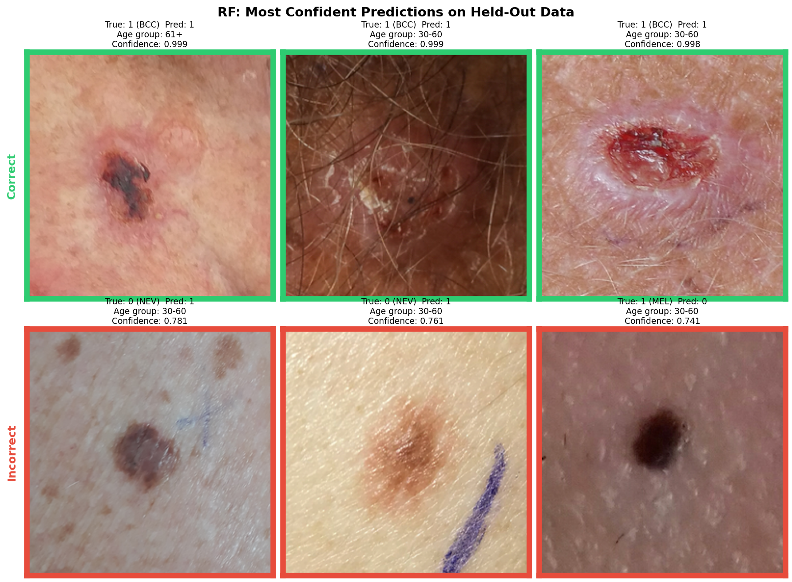
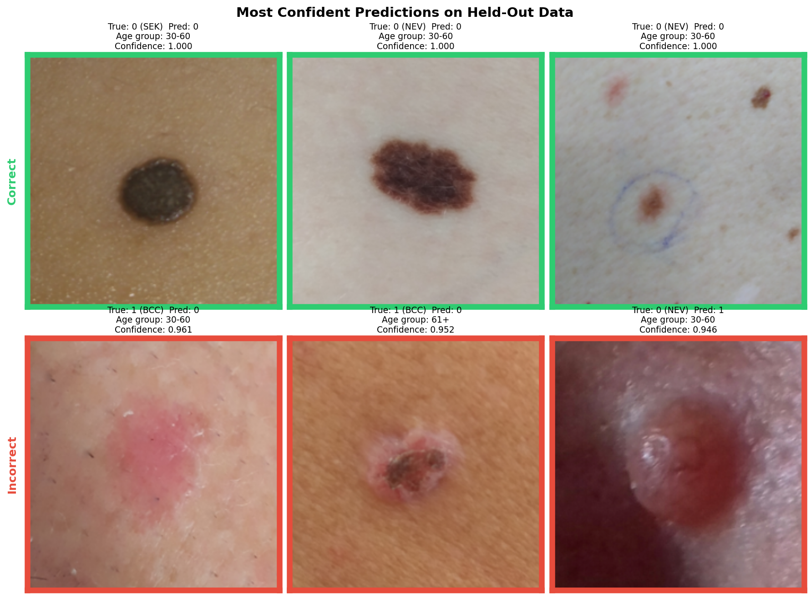

# Skin Lesion Triage: Random Forest vs. Image + Clinical Fusion Model

Classifying smartphone photos of skin lesions as **needing treatment or not**, using images plus patient clinical metadata from [PAD-UFES-20](https://doi.org/10.1016/j.dib.2020.106221) (Pacheco et al., 2020). Built as a two-part project for Tufts CS 135 (Machine Learning).

- **Part 1:** a random forest on engineered image features and clinical metadata.
- **Part 2:** a fusion model combining a pretrained EfficientNet-B0 image embedding with a clinical-feature MLP, designed to be robust across patient age groups.

**Why the metric matters:** the data is dominated by older patients and by one lesion type (BCC, ~57% of training images). A model can score well overall while failing a minority group, so models were selected by **minimum age-group AUROC**: AUROC computed within each age group (0–29, 30–60, 61+), keeping the worst one.

---

## Results

Test-set results as scored by the course autograder:

| Model | Test AUROC | Min age-group AUROC | Balanced accuracy |
|---|---|---|---|
| Random forest | **0.901** | not reported | 0.650 |
| Fusion model | 0.863 | **0.797** | **0.793** |

The random forest **ranks** lesions better overall, but its default operating point is heavily skewed: it flags almost every lesion as needing treatment. The fusion model's class × age sampler gives it a far more balanced operating point and good performance across age groups.

---

## Approach

### Part 1: Random forest

- **Features:** three global image features (mean color intensity, color variance, edge density) merged with clinical metadata. Missing clinical fields are coded as an explicit `"Missing"` category rather than dropped, since in this dataset a blank often means "unverified," not "negative."
- **Imbalance:** rare classes are augmented in the training data only (flips, rotations, mild brightness/contrast changes), scaled to class rarity (6× MEL/SEK down to 0× BCC), plus balanced class weights.
- **Validation:** 5-fold `StratifiedGroupKFold` grouped by patient, so no patient appears in both training and validation data. Augmentation happens after splitting.
- **Tuning:** greedy one-at-a-time search over `max_depth`, `min_samples_leaf`, `n_estimators`, and `min_samples_split`, scored by minimum age-group macro AUROC. Per-class decision thresholds (MEL 0.10, NEV 0.25) were explored separately to understand the precision/recall trade-off.
- **Final model:** 600 trees, max depth 15, `max_features="sqrt"`, min split 12, min leaf 5. The test score is P(ACK) + P(BCC) + P(MEL) + P(SCC).

### Part 2: Fusion model

- **Architecture:** a frozen, ImageNet-pretrained EfficientNet-B0 produces a 256-d image embedding, concatenated with an MLP embedding of the clinical features and passed to a small classification head. Only the head layers are trained, which limits overfitting on ~1,200 images.
- **Features:** an ablation study chose diameter mean, diameter > 6 mm, and edge density as the engineered features (inspired by the dermatology ABCDE criteria). Adding every candidate feature performed worst.
- **Imbalance, the biggest change:** a `WeightedRandomSampler` over **class × age-group** cells, with weight (1/count)^power, so rare combinations such as benign lesions in older patients are drawn more often. Negatives in the 61+ group get an extra 1.5× boost after the model systematically misclassified them.
- **Tuning:** a default 5-fold CV run (min age-group AUROC 0.856 ± 0.066), then an 8-run **fractional factorial** search over learning rate, weight decay, dropout, and sampler power. Learning rate and sampler power had the largest effects. The single best configuration (0.871 ± 0.085) was rejected for its larger fold-to-fold variance.
- **Final model:** lr 1e-3, weight decay 1e-4, dropout 0.3, batch size 16, sampler power 0.2, early stopping (patience 3) on validation minimum age-group AUROC.

---

## Error analysis

The 3 most confidently correct (top row) and incorrect (bottom row) predictions of each model on the same held-out validation patients:

| Random forest | Fusion model |
|---|---|
|  |  |

The two models fail on **different** lesions:

- **Fusion model:** most confident on dark, sharply bordered benign moles; confidently misses pink, non-pigmented BCCs. Its image embedding appears to rely heavily on pigmentation and contrast.
- **Random forest:** most confident on BCCs with clinically obvious presentations, likely driven by clinical metadata rather than its three coarse image features; misclassifies pigmented lesions. Both of its confident false positives contain surgical-marker ink, which inflates edge density.

Because their errors differ, an ensemble of the two is a natural next step.

---

## Repository structure

```
projectB_final/
├── data/
│   ├── README.md              # what data goes here
│   └── make_img_features.py   # step 0: image features for the RF
├── RF_model/
│   ├── train_rf.py            # single-split exploration + threshold analysis
│   ├── train_rf.sh
│   ├── cv_search_rf.py        # 5-fold CV hyperparameter search
│   └── test_predictions_part1.py  # final RF, test predictions, held-out figure
├── fusion_model/
│   ├── cross_validate.py      # 5-fold CV for the fusion model
│   ├── run_default_cv.sh      # default configuration CV
│   ├── run_factorial_search.sh  # 8-run fractional factorial search
│   └── train_final.py         # final model, test predictions, held-out figure
├── error_figures/
│   ├── confidence_grid_cnn.png
│   ├── rf_confidence_grid_heldout.ong
└── project_B_summary.pdf
```

### Run order

All scripts read and write files in `data/`, so run them from there (the `.sh` files do this for you; they were written for a Slurm cluster).

**Random forest**
1. `python make_img_features.py`
2. `python ../RF_model/train_rf.py --img-features x_train_img_features.csv --augment-rare`
3. `python ../RF_model/cv_search_rf.py` (the repo version is the last of four sweeps; the full search history is in its docstring)
4. `python ../RF_model/test_predictions_part1.py`

**Fusion model**
1. `python ../fusion_model/cross_validate.py --sampler-power 0.15 --run-name default_run`
2. `sbatch fusion_model/run_factorial_search.sh` (from the repo root)
3. `python ../fusion_model/train_final.py`

---

## Data

Data files are not included (GitHub size limits and course distribution). The images and metadata come from the public PAD-UFES-20 dataset. See [`data/README.md`](data/README.md) for the expected files.

---

## Limitations and next steps

- **CV-to-test drop:** the fusion model's minimum age-group AUROC fell from 0.856 in CV to 0.797 on test. Fold variance was high, and several design choices (feature set, sampler multiplier) were made after inspecting CV results, which makes the CV estimate somewhat optimistic. Nested CV would give a cleaner estimate.
- **Sampler power:** the reported CV run used power 0.15; the final model used 0.2, which beat 0.1 in the factorial search. 0.15 and 0.2 were never compared directly.
- **Missingness in the fusion model:** unlike the random forest, it imputes missing categorical fields with the most frequent value, which erases the "unverified" signal. Missing diameters also default to "not > 6 mm."
- **Edge density** is computed over the whole image, so hair, skin texture, and surgical-marker ink all count as edges. Lesion segmentation would make it a true border measure.
- **Single split:** the final fusion model trains on one 80% split. Ensembling the five fold models, or combining the random forest and fusion model, are natural improvements.

---

## Notes

- The code was cleaned for readability after the results were produced. Changes are limited to comments, naming, logging, and removal of unused code; training behavior is unchanged.
- The RF image-feature files were regenerated with `make_img_features.py` after the original run. The reported test scores come from the original submission.

**Full write-up:** [project_B_summary.pdf](project_B_summary.pdf)
